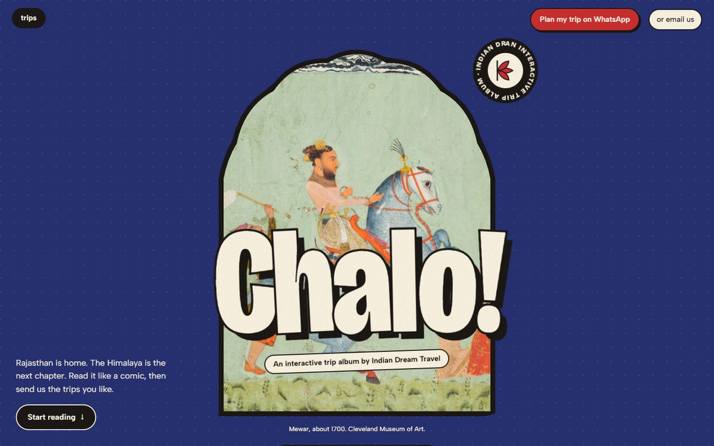
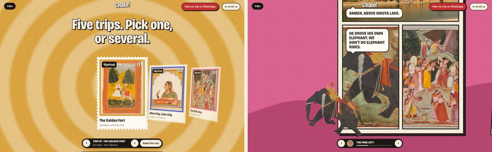

# Chalo!

An interactive trip album for Indian Dream Travel: Rajasthan and the Himalaya told as comic pages, with 300-year-old Rajput paintings cut into moving paper puppets.

**Live:** https://avanishjha.dev/chalo/





> **Work in progress.** This is a design prototype, not the client's live site. Prices, nights, contact details and policies in brackets (`₹[price]`, `[n] nights`, `[WhatsApp number]`) are placeholders, and there is no WhatsApp number wired in yet. The page asks search engines not to index it.

## What happens on the page

- **Arrival.** An ink stamp flips through silhouettes of the puppets, then morphs into a cusped Mewar arch.
- **Puppet hero.** A Mewar painting (about 1700) is cut into five pieces. The horse rocks and swishes its tail, the attendant waves his fly whisk, and a camel from another painting photobombs from the edge. Each layer moves with the pointer at its own depth, and hovering a figure glitches it with a short red and blue split.
- **Painting to ink.** Scrolling turns the painting into its own ink drawing, then an iris of colour opens onto the trips.
- **Trip carousel.** Five trips are perforated stamps in a 3D carousel. Behind them, a small WebGL shader draws rings in the active trip's colours, and each trip repaints the screen.
- **Next stop is loading.** Opening a trip gives a short dark beat over a faint ink drawing of that place, then a wavy curtain lifts onto the chapter.
- **Comic chapters.** Native scroll drives a camera across tilted comic pages, panel by panel. Speech bubbles pop in when the camera arrives, sound words (THUD., CHHAPAK!, POM POM!) break past the panel borders, a brass lantern swings when the camera moves, kites fly over Jaipur, and an elephant puppet with two riders steps out of its panel.
- **Your message.** Trips you add, plus a few quick questions, are written into a WhatsApp or email message you can edit before sending. There is no login, booking or payment.

## How it works

- Plain HTML, CSS and JavaScript, built with Vite. No framework.
- Native scroll is the source of truth. Each chapter is a tall section with a sticky stage, and scroll progress interpolates a camera (position, scale and tilt) between panel keyframes.
- The puppets are transparent cut-outs made from the museum scans by colour segmentation, each rotated around its own joint with the Web Animations API. Phones load smaller copies.
- The ink drawings are made with an extended difference-of-Gaussians filter.
- The rings are one fragment shader at half resolution, paused when off screen.

### Accessibility and fallbacks

- **Reduced motion:** with `prefers-reduced-motion`, the camera, loader and carousel switch off. The pages stack as plain readable comics, and the hero is a still painting.
- **Keyboard:** the arrow keys move panel by panel, and every control can be reached with Tab.
- **Without JavaScript:** the page still reads top to bottom.

## Run it locally

Any static server works. From this folder:

```bash
python -m http.server 8000
```

Then open http://localhost:8000/. Opening `index.html` straight from disk will not work, because the scripts are ES modules.

## What's in this repository

This repository holds the built site only, ready for GitHub Pages:

```text
index.html        the page
assets/           built JavaScript and CSS
img/art/          paintings (Cleveland Museum of Art, CC0)
img/puppets/      puppet pieces cut from those paintings (full and -sm phone sizes)
img/ink/          ink drawings of chapter photos
img/*.webp        photos (Wikimedia Commons)
```

Network: fonts load from Google Fonts. Everything else is in this folder.

## Credits and inspiration

- **Paintings:** Cleveland Museum of Art Open Access, CC0.
- **Photos:** Wikimedia Commons, under CC BY, CC BY-SA and FAL licences. Every photographer, licence and source link is listed under "Picture credits" at the bottom of the page.
- **Inspiration:** the comic-camera idea, puppet characters and loading beats are inspired by [Ponpon Mania](https://ponpon-mania.com/). This project is not affiliated with it, and it uses none of its art or code.

No licence is granted for reusing the code in this repository. The images keep their own licences, listed on the page.
